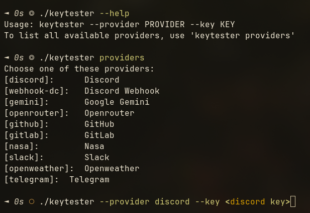

# Keytester

Keytester is a program that can test if your api keys work. It supports multiple services, right now being 10+, but continuously expanding.
It is written in C, using the `libcurl` library for requests.

This is my first ever C program, so expect some bugs to possibly exist. I made it for HackClub's [Terra](https://terra.hackclub.com) program.

# Screenshot



## Key providers:

The following api providers are implemented right now:

| Service            | Parameter         |
| ------------------ | ----------------- |
| Discord (bots)     | `discord`         |
| Discord (webhooks) | `webhook-discord` |
| Google gemini      | `gemini`          |
| Openrouter         | `openrouter`      |
| GitHub             | `github`          |
| GitLab             | `gitlab`          |
| Nasa               | `nasa`            |
| Slack              | `slack`           |
| OpenWeather        | `openweather`     |
| Telegram (bots)    | `telegram`        |

# Requirements

Currently this project requires you to be on a linux system. Windows support is planned to be implemented later.

# Usage:

To use the program, you should first download it from github releases or [build it from source](#building-from-source)
Then locate the downloaded/built file, and give it excecutable permissions:

```
chmod +x ./keytester
```

Then run the file:

```
./keytester --help # Shows command usage
./keytester providers # Lists all providers
./keytester --provider discord --key <your token> # Tests a discord bot token.
```

# Building from source

To build from source you need the following dependencies:
`curl`, `make` and `gcc` (Often added with `base-devel` on Arch-like systems or `build-essential` on Debian)

Firstly, clone the repository:

```
git clone https://github.com/ItsGoldMonke/Keytester.git
cd Keytester
```

Then compile the project:

```
make
```

Then your binary should be built as `bin/keytester`.

# Disclaimer

You should only use this with your OWN keys, tokens, and links, or ones you are permitted to use.

# Credits

This project was heavily inspired by [Keylyzer](https://github.com/SyscallX-18113/Keylyzer), as it inspired me to make a similar program.
